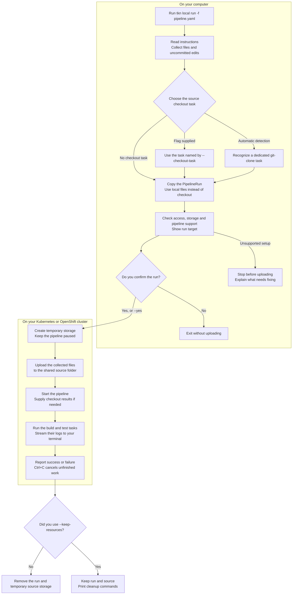

# tkn-local

Run a Tekton pipeline on your cluster using files from your computer, including
edits you haven't committed or pushed. Follow the build and test logs in your
terminal.

## Install

You need Git, [tkn](https://tekton.dev/docs/cli/), and a Kubernetes cluster with
Tekton and persistent storage. Your source directory must be a Git working tree
with at least one commit.

```sh
go install github.com/pipelines-as-code/tkn-local/cmd/tkn-local@latest
```

Put your Go binary directory on `PATH` so `tkn` can find the plugin.

## Run

Run this from the root of your Git working tree:

```sh
tkn local run -f examples/git-or-local.yaml
```

The command uses your current cluster and namespace from kubeconfig. Override
them with `--context` and `--namespace/-n`. Use `--source` for another working
tree.

The plugin looks for Tekton in `openshift-pipelines` on OpenShift and
`tekton-pipelines` elsewhere. Use `--tekton-namespace` for a custom installation.

The file must contain exactly one PipelineRun: the instructions for one pipeline
execution. It can include Task and Pipeline definitions, or reference definitions
in `.tekton`. The plugin works on a copy and leaves your YAML unchanged.

Your Pipeline needs a workspace, the shared folder where Tasks read your source.
Its name defaults to `source`; use `--workspace` for another name. The plugin sets
shared file permissions and uses the namespace's assigned user and group IDs on
OpenShift. Any user or group IDs in your YAML must fit the namespace policy.
See [examples/local.yaml](examples/local.yaml) for a pipeline without checkout.

Pass string parameters with `-p`:

```sh
tkn local run -f examples/local.yaml -p message=hello
```

## How it works

The plugin collects your current files, uploads them to a shared folder on the
cluster, and starts the pipeline after the upload finishes. For a recognized
checkout Task, it substitutes a small Task that uses those files and supplies
the checkout results needed by later Tasks. Source checkout needs no Git-server
access.



The upload includes tracked files and untracked files that Git doesn't ignore.
Each run uses the files collected at the start; edits made afterward need another
run.

## Use the same PipelineRun in CI

Submit [examples/git-or-local.yaml](examples/git-or-local.yaml) to the cluster
for a normal Git checkout:

```sh
kubectl create -f examples/git-or-local.yaml
```

Use the same file with your local edits:

```sh
tkn local run -f examples/git-or-local.yaml
```

In CI, the checkout Task fetches the configured Git revision. Locally, the plugin
replaces that Task and uses your uploaded files. The build and test Tasks read
the same `source` workspace in both cases. Set `url` and `revision` for your
repository when running in CI.

Select a custom checkout Task by its name in the Pipeline:

```sh
tkn local run -f pipeline.yaml --checkout-task fetch-source
```

The override replaces the entire named Task. Use it for a Task dedicated to
fetching source; any build or setup work inside that Task would also be removed.

The replacement supplies declared `commit`, `url`, and `committer-date` results.
`commit` is your local HEAD, the last committed version, and `committer-date` is
that commit's timestamp. `url` keeps the checkout Task's configured URL. Your
uploaded files can contain edits beyond that commit.

## Limits

Automatic detection accepts a dedicated `git-clone` Task, or a local reference to
one, with a single step named `clone` and no sidecars. Custom checkout images can
hide their Git commands; use `--checkout-task` to identify them. One source
checkout at the workspace root is supported.

The upload excludes `.git`, so build Tasks cannot use Git history for commands
such as `git describe`. Symlinks and submodules are unsupported. Tasks that need
checkout results other than the three listed above cannot use the replacement.

Task and Pipeline references must resolve from the selected file or `.tekton`.
Remote resolvers, Custom Tasks, and StepAction references are unsupported.

## Debug

Press Ctrl+C to cancel. The plugin removes the run and temporary source storage
after completion, failure, or cancellation. Keep them for inspection with:

```sh
tkn local run -f examples/local.yaml --keep-resources
```

For retained resources, the plugin prints inspection and cleanup commands. Use
`--yes` to skip confirmation in scripts. Tasks run your code with their configured
service accounts, credentials, and network access; use a development namespace.

The execution timeout defaults to one hour. Change it with `--timeout`. Temporary
storage defaults to `1Gi` on the cluster's default StorageClass; override these
with `--storage-size` and `--storage-class`.

## Develop

```sh
make build
make test
```

`make e2e` runs against your current cluster, creates a temporary namespace, and
removes it afterward. It requires `tkn`, Tekton, and a default StorageClass.
